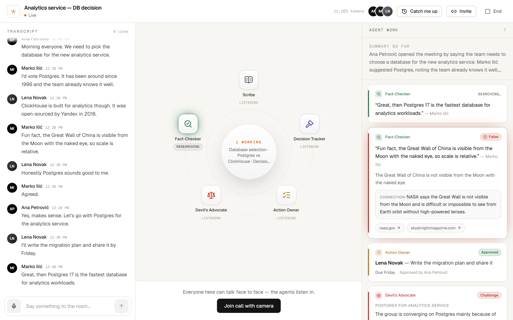
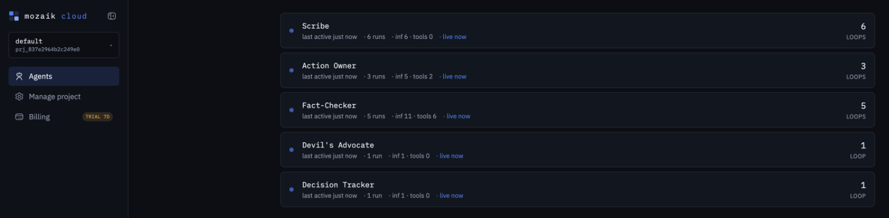
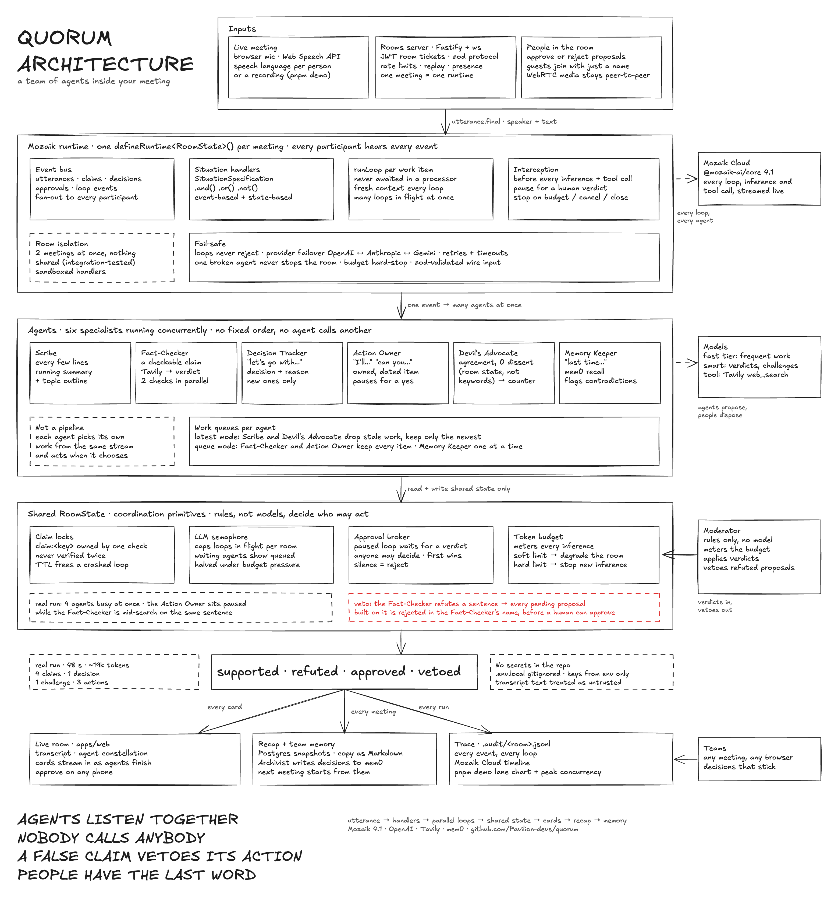

<div align="center">

# Quorum

### A team of AI agents that works inside your meeting — at the same time as you.

**Six specialist agents listen to the same live conversation concurrently on one Mozaik runtime. They fact-check claims as they're said, record decisions, draft owned action items, push back on groupthink and recall past meetings, and they coordinate through shared room state, not a pipeline.**

[](LICENSE)
[](https://github.com/jigjoy-ai/mozaik)
[](tsconfig.base.json)
[](#)

**[▶ Watch the 90-second demo](apps/web/public/product/quorum-demo.mp4)**



</div>

---

## Run it in one command

You need **Node 24+**, **pnpm 11+** and **one model key** (OpenAI, Anthropic or Gemini). A [Tavily](https://tavily.com) key turns on the Fact-Checker; without it, that agent switches itself off and says so.

```bash
git clone https://github.com/Pavilion-devs/quorum && cd quorum
pnpm install
cp .env.example .env.local     # add OPENAI_API_KEY (or ANTHROPIC_API_KEY / GEMINI_API_KEY) + TAVILY_API_KEY
pnpm demo
```

`pnpm demo` streams a recorded meeting ([`samples/demo.txt`](packages/engine/samples/demo.txt)) into the **real engine** at speaking pace, using real models, real web search and a real Mozaik runtime. No browser, database or sign-in. You'll watch:

- several agents **thinking at the same time** on the same sentence,
- the Fact-Checker **refuting** a false claim with sources, and **vetoing** the action item that depended on it,
- the Devil's Advocate stepping in when the room agrees **too quickly** (triggered by room state, not keywords),
- action items **pausing for approval** before anything is recorded,
- a closing **lane chart** of every agent's activity and the peak number of agents working at once, plus a JSONL trace in `.audit/`.

An actual run (OpenAI + Tavily, 48 s, ~19k tokens), trimmed to the cards:

```
  20.9s [supported] FACT "It was open-sourced by Yandex in 2016." — ClickHouse was released as open source by Yandex in 2016.
  24.3s ◆ DECISION Use Postgres for the analytics service.
  26.3s CHALLENGE (Postgres for analytics service) The case for Postgres is mostly familiarity and first-year row count, not query shape…
  27.4s APPROVAL apr_7: Marko: Set up the staging database (due Thursday)
  31.4s ACTION [approved by You] Marko: Set up the staging database — Thursday
  34.3s APPROVAL apr_a: Lena: Put a photo of the Great Wall of China on the launch slide (due Monday)
  39.2s [false] FACT "Since the Great Wall of China is visible from the Moon with the naked eye, …" — The Great Wall of China is not visible from the Moon with the naked eye.
  39.2s ACTION [rejected by Fact-Checker] Lena: Put a photo of the Great Wall of China on the launch slide — Monday

── Concurrency
Scribe           │███████████·········██████████████····████············██████····│
Fact-Checker     │·····███████▓▓▓▓▓███████████·▓▓▓▓▓████···████▓▓▓████············│
Decision Tracker │·····························████·······························│
Devil's Advocate │·····························██████·····························│
Action Owner     │··································██▒▒▒▒▒████▒▒▒▒▒▒█████▒▒▒▒▒███│
                 0s                                                          48s
█ thinking  ▓ tool call  ▒ paused for approval  ░ queued (room semaphore)
peak 4 agents busy at once (22.2s: Scribe, Decision Tracker, Devil's Advocate, Fact-Checker) · 28.4s with 2+ agents working in parallel
```

Look at 34–39 s. The Action Owner's loop is **paused** waiting for a human (`▒`) while the Fact-Checker is mid-**web search** (`▓`) on the same sentence. The refutation lands first, so the proposal is rejected *by the Fact-Checker* before anyone could approve it.

Set `MOZAIK_API_KEY` (or run `npx @mozaik-ai/cloud-sdk pair` once) and the run also streams to **Mozaik Cloud**; the live link prints in the terminal.
Here's the same run in Mozaik Cloud: five agents, each with its own loops, inference calls and tool calls, all live together.



Other modes: `pnpm spike` (type the meeting yourself, approve with `/approve <id>`), `pnpm spike --file packages/engine/samples/demo.txt --rooms 3` (three isolated meetings in parallel). The full video-meeting app is under [Full app](#full-app-getting-started).

## How the agents run concurrently



<sub>Editable source: <a href="apps/web/public/product/architecture.excalidraw">architecture.excalidraw</a> (open it at excalidraw.com).</sub>

**Nobody calls anybody.** Every agent is a Mozaik participant with its own **situation handlers**. Each one hears every event on the room's bus and decides for itself whether to act. Work runs as independent `runLoop`s, so several agents are mid-inference or mid-tool-call at once. The lane chart at the end of `pnpm demo` shows it.

| Mechanism | Where | What it does |
|---|---|---|
| **One runtime per room** | [`room-runtime.ts`](packages/engine/src/mozaik/room-runtime.ts) | `defineRuntime<RoomState>()` per meeting. Rooms never share state (integration-tested with 2 rooms at once). |
| **Event-based handlers** | [`specs.ts`](packages/engine/src/mozaik/specs.ts), [`agent-participant.ts`](packages/engine/src/mozaik/agent-participant.ts) | `SituationSpecification`s composed with `.and/.or/.not` (e.g. *a final utterance, not from me*). |
| **State-based handler** | [`devils-advocate.ts`](packages/engine/src/agents/devils-advocate.ts) | Fires when the shared store shows **consensus without dissent** (≥ N agreements, 0 counterpoints), not on a keyword. |
| **Claim locks** | [`fact-checker.ts`](packages/engine/src/agents/fact-checker.ts), [`lock-table.ts`](packages/engine/src/domain/lock-table.ts) | Up to 2 checks in parallel. Each claim is locked by the check that owns it, so it's never verified twice. Locks have TTLs, so a crashed loop can't hold one forever. |
| **LLM semaphore** | [`semaphore.ts`](packages/engine/src/domain/semaphore.ts) | Caps loops in flight per room. Agents waiting on it show as *queued*. |
| **Work queues per agent** | [`work-queue.ts`](packages/engine/src/domain/work-queue.ts) | `latest` mode (Scribe and Devil's Advocate drop stale work) or `queue` mode (Fact-Checker and Action Owner keep every item). |
| **Human-in-the-loop interception** | [`interception.ts`](packages/engine/src/mozaik/interception.ts) | Every consequential tool call is intercepted before it runs. The loop pauses until someone decides. Silence = reject. Approval stamps the model forges itself are stripped. |
| **Agent-to-agent veto** | [`moderator.ts`](packages/engine/src/mozaik/moderator.ts) | When the Fact-Checker refutes a statement, any pending proposal built on that sentence is rejected *in the Fact-Checker's name*, while that loop is still paused. |
| **Budget-aware degradation** | [`moderator.ts`](packages/engine/src/mozaik/moderator.ts), [`token-budget.ts`](packages/engine/src/domain/token-budget.ts) | Meters every inference. Under pressure it halves the semaphore; at the hard limit interception stops new inference. |
| **Failure isolation** | [`safe.ts`](packages/engine/src/mozaik/safe.ts), [`resilient-runner.ts`](packages/engine/src/mozaik/resilient-runner.ts) | Handlers are sandboxed, loops never reject, and providers fail over with retries and timeouts. One broken agent never stops the room. |

## The agent team

| Agent | Wakes up when… | Does | Model tier |
|---|---|---|---|
| **Scribe** | every few lines | running summary + topic outline | fast |
| **Fact-Checker** | a checkable claim is made | web search → verdict, correction, sources | smart |
| **Decision Tracker** | commitment language | records new decisions with rationale | fast |
| **Action Owner** | "I'll…", "can you…" | proposes action items → **pauses for approval** | fast |
| **Devil's Advocate** | agreement piles up with no pushback (*room state*, not a keyword) | strongest counter-argument + one question | smart |
| **Memory Keeper** | a decision is recorded, or someone says "last time…" | searches team memory; flags contradictions | fast |

Plus three rule-based participants: the **Moderator** (budgets, approvals, vetoes a proposal when the Fact-Checker refutes its premise), the **Archivist** (writes decisions to team memory) and the **Tap** (streams events to the browser).

## The problem

Meetings are where organisations decide things — and where those decisions get lost.

- **Wrong facts go unchallenged.** A confident wrong number in a meeting becomes the basis of a decision.
- **Decisions evaporate.** Two weeks later nobody agrees on what was agreed, or why.
- **"I'll do it" never becomes a task.** Commitments made out loud aren't written down, owned or dated.
- **Groupthink wins.** When a room agrees quickly, nobody asks the uncomfortable question.
- **Every meeting starts from zero.** Teams re-decide things they already decided — or contradict themselves without noticing.
- **Late joiners are lost**, and people who couldn't attend have nothing reliable to read.

Today's tools split this badly: a call app shows faces, and an AI note-taker writes a summary *afterwards*. By then the wrong fact has already shaped the decision.

## The solution

**Quorum puts a team of specialist AI agents inside the meeting room.** You talk face to face — in the browser, no install — and while you talk, the agents work **at the same time**:

| | |
|---|---|
| A claim is made | the **Fact-Checker** verifies it against the web, with sources and a correction |
| The room commits | the **Decision Tracker** records the decision and the reason |
| Someone says "I'll…" | the **Action Owner** drafts an owned, dated action item — and **waits for a human yes** |
| Everyone agrees too fast | the **Devil's Advocate** raises the strongest counter-argument |
| A decision contradicts last month | the **Memory Keeper** flags it, quoting the earlier meeting |
| Always | the **Scribe** keeps a running summary, so late joiners catch up in seconds |

When the host ends the meeting, everyone lands on the same **recap**.

## Features

**Meetings**
- HD video and audio calls in the browser (WebRTC), guests join with just a name
- Mute / unmute, camera on / off, **screen sharing** with presenter layout
- **Data-saver mode** (360p, 15 fps, capped bitrate) for mobile networks
- **Chat** with **file sharing** (PDF, images, Office files, CSV — up to 10 MB)
- Invite by link, **WhatsApp**, email or the phone's share sheet
- Speech recognition in **African languages and accents** — English (Nigeria, Kenya, South Africa, Ghana, Tanzania), Kiswahili, isiZulu, Afrikaans, Amharic, Arabic, French, Portuguese
- **Catch me up** — what you missed, opened automatically for late joiners

**Intelligence**
- Five concurrent agents + team memory across meetings (see below)
- Human approval before anything is done on someone's behalf
- Every fact-check cites its sources; "can't verify" beats guessing

**Records**
- Live transcript, decisions, action items, fact-checks, challenges and chat — saved
- Recap page with **copy as Markdown** for Slack, Notion, Linear or email

## How we use each technology

| Technology | How Quorum uses it |
|---|---|
| **[Mozaik](https://github.com/jigjoy-ai/mozaik)** (`@mozaik-ai/core` 4.1) | The heart. One runtime per meeting; every agent, human and observer is a Mozaik **participant**; agents react through **situation handlers** (event- *and* state-based); **interception** pauses tool calls for human approval and lets one agent stop another; **shared RuntimeState** carries locks, a loop semaphore and the token budget. We also harden it: loops never reject, handlers are isolated, fresh context per loop ([details](RESEARCH.md#runtime-behaviours-found-while-building-410--and-how-we-handle-them)). |
| **OpenAI** (and Anthropic, Gemini) | Model inference through Mozaik's provider layer. Fast models for frequent work, smart models for verdicts and challenges; automatic **cross-provider failover**, retries and timeouts; structured (schema-validated) outputs. |
| **[Tavily](https://tavily.com)** | The Fact-Checker's `web_search` tool: focused queries, results with URLs the model must cite. |
| **[mem0](https://mem0.ai)** | Team memory across meetings: the Archivist stores decisions and approved actions; the Memory Keeper searches them and flags contradictions. |
| **WebRTC** | Peer-to-peer video, audio and screen share with "perfect negotiation"; media never touches our servers. |
| **Next.js 16 + Better Auth** | Web app, accounts, guest (anonymous) sessions, room tickets, file sharing, recap. |
| **Postgres (Neon) + Drizzle** | Users, rooms, meeting snapshots, shared files. |
| **Fastify + ws** | The real-time room server. |

## Architecture

Three deployables, one repo:

| Part | Tech | Role |
|---|---|---|
| `apps/web` | Next.js 16, Better Auth | Landing, accounts, dashboard, room UI, recap, uploads, room tickets |
| `apps/rooms` | Fastify + WebSockets + Mozaik | Live rooms: one agent runtime per meeting, event streaming, WebRTC signalling |
| `packages/engine` | TypeScript + Mozaik | Agents, shared state, coordination, resilience |
| `packages/protocol` | zod | The wire contract between browser and room server |
| `packages/db` | Drizzle + Postgres | Schema and migrations |

Deep dives: [ARCHITECTURE.md](ARCHITECTURE.md) · [SYSTEM-DESIGN.md](SYSTEM-DESIGN.md) · [RESEARCH.md](RESEARCH.md).

## Scale

Measured on one process: **1,000 live sockets across 200 meetings, p95 event latency 37 ms, zero message loss** ([load test](apps/rooms/scripts/loadtest.ts)). Room servers scale horizontally with **rendezvous-hash routing** — no coordinator, adding a machine moves only ~1/N meetings. The real constraint at millions of users is model throughput and cost; the plan is in [SYSTEM-DESIGN.md](SYSTEM-DESIGN.md#4-capacity--the-real-bottleneck-is-model-throughput-and-cost).

## Why it matters — especially in Africa

- **Data is expensive and networks vary.** Heavy desktop apps and high-bitrate video exclude people on mobile data. Quorum runs in the browser with a **data-saver mode**.
- **People speak many languages and accents.** Transcription tuned for American English fails on Nigerian, Kenyan, South African or Ghanaian English, Kiswahili or isiZulu. Quorum lets every participant pick their own speech language.
- **WhatsApp is how people share.** Invites go out over WhatsApp in one tap.
- **Distributed teams can't afford re-work.** Startups, NGOs, governments and universities across the continent need decisions that stick.

## Full app: getting started

**Requirements:** Node 24+, pnpm 11+, Chrome or Edge (for live speech).

```bash
git clone https://github.com/Pavilion-devs/quorum && cd quorum
pnpm install
cp .env.example .env.local          # then fill in keys (see below)
pnpm db:local                       # terminal 1 — local Postgres (or use Neon)
pnpm db:migrate
pnpm --filter @quorum/rooms dev     # terminal 2 — room server  :4000
pnpm --filter @quorum/web dev       # terminal 3 — web app      :3000
```

Open http://localhost:3000, create an account, start a room, share the link.

## Configuration

All apps read one root `.env.local` (never committed). Minimum to run:

| Variable | Needed for |
|---|---|
| `OPENAI_API_KEY` (or `ANTHROPIC_API_KEY` / `GEMINI_API_KEY`) | the agents |
| `TAVILY_API_KEY` | the Fact-Checker |
| `MEM0_API_KEY` | the Memory Keeper |
| `DATABASE_URL` | accounts, rooms, recaps, files |
| `BETTER_AUTH_SECRET`, `BETTER_AUTH_URL` | sign-in |
| `ROOMS_JWT_SECRET`, `NEXT_PUBLIC_ROOMS_URL` | web ↔ room server |
| `NEXT_PUBLIC_TURN_URLS` (+ username/credential) | calls on strict networks (production) |

Full list with comments: [.env.example](.env.example).

## Testing

```bash
pnpm --filter @quorum/engine test   # 27 unit + integration (real Mozaik runtime, scripted model)
pnpm --filter @quorum/rooms test    # 10 server tests (real WebSockets, JWTs, routing)
pnpm e2e                            # 6 browser tests (real models, real mem0, real WebRTC)
```

The end-to-end suite holds a full meeting in two real browsers: sign-up → room → guest joins → **live video both ways** → mute, camera, data saver, **screen share** → invite → **chat with a file** → fact-check → decision → approval → action → end → recap; plus a two-meeting **team-memory** test and visual checks on desktop and phone.

## Deployment

Database on **Neon**, room servers on **Fly.io**, web on **Vercel**. Step-by-step: [SETUP.md §5](SETUP.md). Docker image: [`apps/rooms/Dockerfile`](apps/rooms/Dockerfile). CI: [`.github/workflows/ci.yml`](.github/workflows/ci.yml).

## Project structure

```
quorum/
├── .github/
│   └── workflows/            CI pipeline
├── apps/
│   ├── web/                  Next.js app (landing, auth, dashboard, room, recap, uploads)
│   │   ├── e2e/              Playwright end-to-end tests
│   │   ├── public/           static assets
│   │   ├── scripts/          admin and maintenance scripts
│   │   └── src/
│   │       ├── app/          App Router pages and API routes
│   │       ├── components/   UI components
│   │       ├── hooks/        React hooks (room connection, media)
│   │       └── lib/          auth, clients and helpers
│   └── rooms/                real-time room server (Fastify + ws + Mozaik)
│       ├── scripts/
│       ├── src/
│       └── test/
├── packages/
│   ├── engine/               agents, shared state, coordination, resilience
│   │   ├── samples/
│   │   ├── scripts/
│   │   ├── src/
│   │   │   ├── agents/       the agent team
│   │   │   ├── context/      prompt context builders
│   │   │   ├── domain/       Room, Utterance, Claim, Decision, ActionItem
│   │   │   ├── memory/       mem0 team memory
│   │   │   ├── mozaik/       Mozaik adapter (only place that imports it)
│   │   │   ├── observers/    event observers
│   │   │   └── tools/        allowlisted agent tools (web search)
│   │   └── test/
│   ├── protocol/             zod wire contract
│   │   └── src/
│   └── db/                   Drizzle schema + migrations
│       ├── migrations/
│       ├── scripts/
│       └── src/schema/
├── docker-compose.yml
├── package.json
├── pnpm-workspace.yaml
├── turbo.json
└── *.md                      product, architecture, plan and policy docs
```

## Roadmap

- **Large meetings:** SFU (LiveKit / Cloudflare Calls) for calls beyond ~6 video participants
- **More African languages:** Yoruba, Hausa, Igbo, Kinyarwanda, Luganda speech via server-side ASR
- **Live translation** of captions between participants' languages
- **Offline-tolerant mobile app** and USSD/SMS recap delivery
- **Organisations** with shared team memory and admin controls
- Redis (Upstash) room claims and shared rate limits for multi-region clusters

## Contributing, security & privacy

- [CONTRIBUTING.md](CONTRIBUTING.md) — how to set up, conventions, pull requests
- [SECURITY.md](SECURITY.md) — reporting vulnerabilities, our security model
- [PRIVACY.md](PRIVACY.md) — what we store, what we don't, your rights
- [CODE_OF_CONDUCT.md](CODE_OF_CONDUCT.md) — how we treat each other

## License

[MIT](LICENSE) — free to use, modify and distribute.

<div align="center"><sub>Built on <a href="https://github.com/jigjoy-ai/mozaik">Mozaik</a> · Made for the JigJoy × NTP Novi Sad Hackathon 2026</sub></div>
